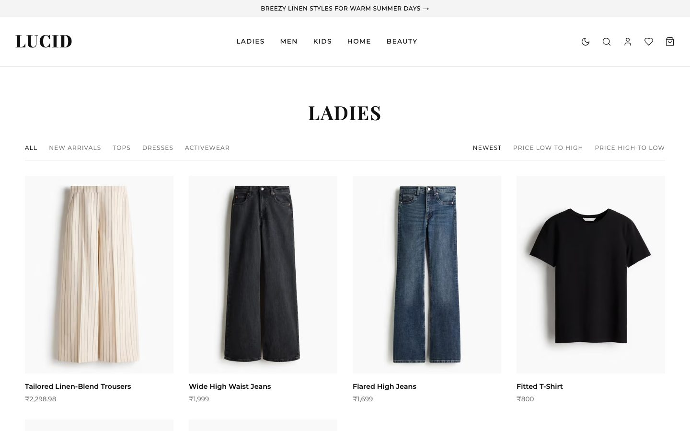
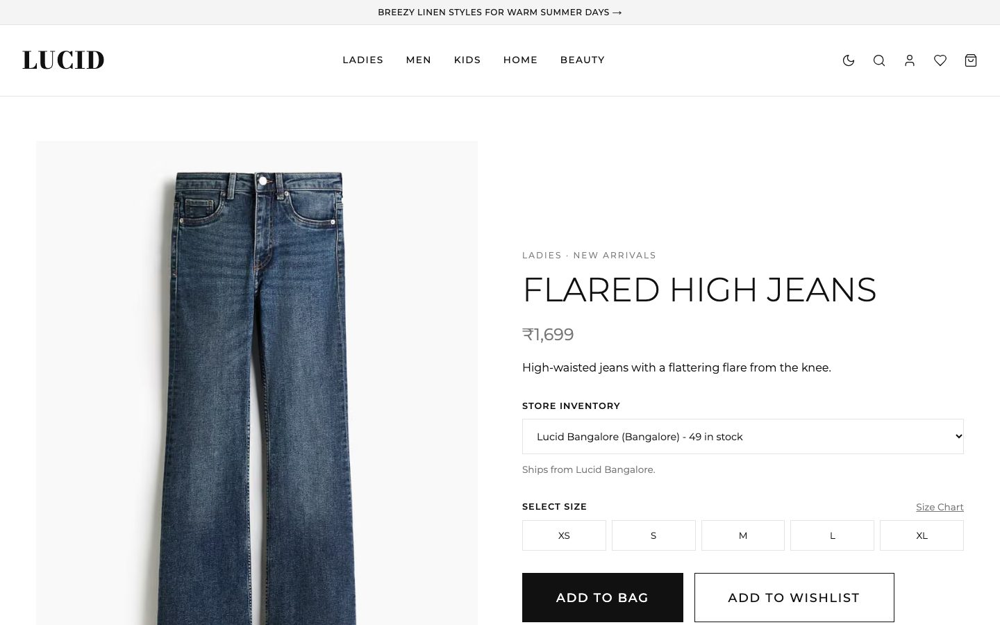
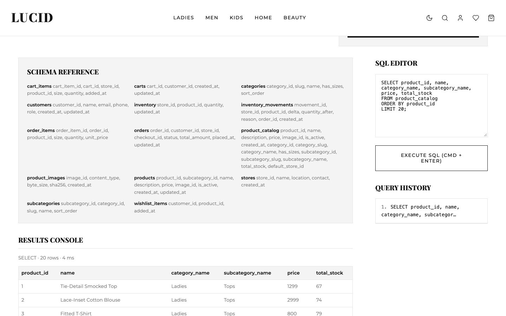

# LUCID

A multi-store clothing retail web application built on PostgreSQL. Customers browse a shared catalogue,
choose which store fulfils each item, and check out. Admins manage orders, stock, stores and products.


## About the project

LUCID started as my Database Systems course project in my fourth semester. The brief was to design and
implement a relational database for a multi-store clothing retailer covering stores, products,
customers, inventory and orders. I later rebuilt it on PostgreSQL as a complete, deployable application.

The aim is to apply database concepts inside a working product rather than in isolated queries:

- **ER modelling and normalisation.** The schema is in third normal form (3NF), with documented,
  deliberate exceptions such as historical prices on order lines.
- **Integrity in the database itself.** Foreign keys (including composite ones), `CHECK` constraints,
  enums and domains keep data valid regardless of which code path writes it.
- **Transactions and concurrency control.** Checkout uses row-level locks taken in a fixed order, so
  concurrent buyers cannot oversell stock, and an idempotency key makes retried requests safe.
- **Triggers, views and indexing.** A trigger-maintained inventory ledger, a catalogue read model,
  full-text and trigram search indexes, and partial indexes.
- **Database security.** Least-privilege roles, hashed credentials, and a sandboxed SQL console.

The schema and design decisions are documented in [`retail-app/docs/database.md`](retail-app/docs/database.md).

## Features

**Storefront**
- Catalogue by category and section, with sorting, pagination, and full-text search that tolerates typos
- Per-store stock on every product page; the shopper picks the fulfilling store
- Shopping bag stored on the server: works for guests and is merged into the account bag at sign-in
- Checkout that splits the bag into one order per store, plus order history and cancellation (which restocks)
- Wishlist, account details, dark mode, and a responsive layout with a mobile menu

**Admin**
- Revenue, order and stock overview, with low-stock alerts
- Order fulfilment (confirmed → shipped → delivered, or cancelled)
- Stock levels per store, with a full movement history
- Adding stores and products (images are stored in the database)
- A read-only SQL console for querying live data

**Security**
- Scrypt password hashing and server-side sessions in httpOnly cookies (only token hashes are stored)
- Role-based access, rate-limited login and registration, and same-origin checks on every write request
- Nonce-based Content Security Policy, request size limits, and safe redirects after sign-in
- The SQL console runs as a separate read-only database role that cannot see credentials or sessions,
  and every query is recorded in an append-only audit log

| Store | Product | SQL console |
| --- | --- | --- |
|  |  |  |

## Tech stack

| Layer | Technology |
| --- | --- |
| Framework | Next.js 16 (App Router), React 19, TypeScript |
| Database | PostgreSQL 14+ via `node-postgres`, using hand-written SQL (no ORM) and versioned migrations |
| Validation | Zod |
| Styling | Plain CSS, with GSAP for the product grid animation |
| Testing | Vitest integration tests against a real PostgreSQL database |
| Tooling | ESLint, GitHub Actions CI, Docker Compose for local PostgreSQL |

## Getting started

**Requirements:** Node.js 20.9+ and PostgreSQL 14+, either installed locally or through Docker.

```bash
git clone https://github.com/SR7D3V/Lucid.git
cd Lucid

# Start PostgreSQL. This creates the "lucid" and "lucid_test" databases.
docker compose up -d

cd retail-app
cp .env.example .env.local            # then edit the values
cp .env.test.example .env.test.local

npm install
npm run db:setup                      # run migrations, then seed the catalogue, stores and admin account
npm run db:console-role               # optional: enables the admin SQL console
npm run dev                           # http://localhost:3000
```

Sign in with the `ADMIN_EMAIL` and `ADMIN_PASSWORD` from `.env.local`, then open `/admin`. To make an
existing account an admin, run `npm run admin:promote -- someone@example.com`.

### Scripts

Run these inside `retail-app/`.

| Command | Purpose |
| --- | --- |
| `npm run dev` / `build` / `start` | Development server, production build, production server |
| `npm run lint` / `typecheck` / `test` | ESLint, TypeScript, integration tests |
| `npm run db:migrate` | Apply pending migrations |
| `npm run db:seed` | Seed stores, products, stock and the first admin (safe to re-run) |
| `npm run db:reset` | Drop and recreate the schema (refuses to run in production) |
| `npm run db:console-role` | Create the read-only role used by the SQL console |
| `npm run db:prune` | Remove expired sessions, stale guest bags and old rate-limit records |

## Project structure

```
retail-app/
├── db/
│   ├── migrations/      schema, constraints, triggers, views and reference data
│   └── seed/            catalogue data and product images
├── docs/                database design notes
├── scripts/             migration, seeding and maintenance scripts
├── src/
│   ├── app/             pages and REST API routes (app/api)
│   ├── components/      shared UI
│   ├── lib/             types and helpers shared by client and server
│   ├── server/          server-only code: database access, sessions, validation, services
│   └── proxy.ts         Content Security Policy
└── tests/               integration tests (checkout concurrency, auth, security)
```

## Testing

```bash
cd retail-app
npm test
```

The suite runs against a disposable PostgreSQL database whose name must end in `_test`. It covers
checkout under concurrent load, idempotent and cancelled orders, bag merging, authentication and
sessions, rate limiting, request hardening, and the SQL console's restrictions. CI runs lint, type
checks, a dependency audit, the tests and a production build on every push.

## Deployment

The app runs on any Node.js host together with a managed PostgreSQL database.

1. Create an application database role that is **not** a superuser, then create the console role with
   `npm run db:console-role`.
2. Set the variables listed in `retail-app/.env.example`. In production, set `APP_ORIGIN` and
   `TRUSTED_PROXY_HOPS` as well.
3. Run `npm run db:migrate` on each release, and `npm run db:seed` once to create the first admin.
4. Serve over HTTPS with `npm run build && npm start`, and schedule `npm run db:prune` to run daily.
