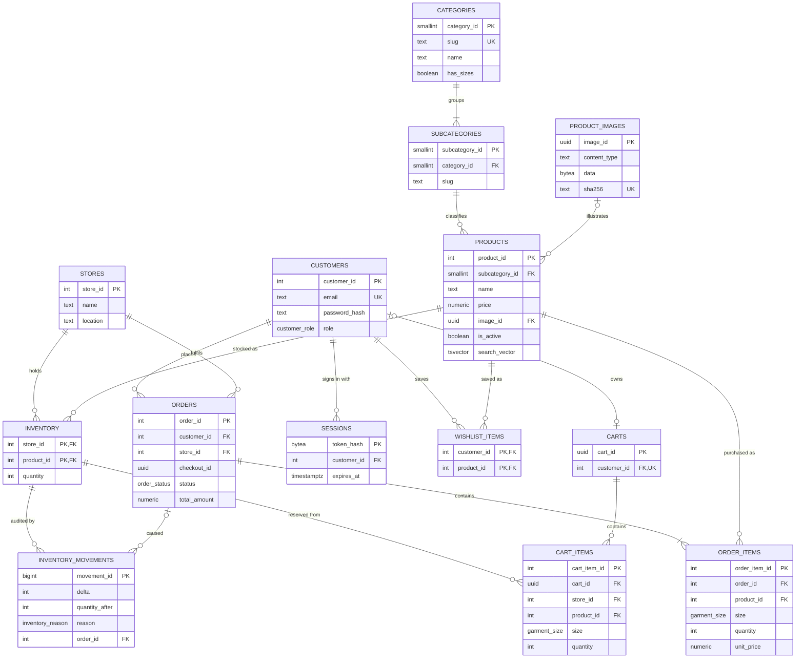

# Database Design

LUCID runs on **PostgreSQL 14+**. The schema lives in versioned migrations under
[`db/migrations`](../db/migrations) and is applied by `npm run db:migrate`.

## Entity-relationship diagram

Supporting tables: `admin_audit_log` (who did what in the admin area, including every SQL
console query), `rate_limits` (an `UNLOGGED` fixed-window counter) and `schema_migrations`.

## Types and constraints

| Object | Purpose |
| --- | --- |
| `order_status` enum | `confirmed → shipped → delivered`, or `confirmed → cancelled` (transitions enforced in `services/orders.ts`). |
| `inventory_reason` enum | `restock`, `adjustment`, `sale`, `cancellation`, `sql_console`. |
| `garment_size` domain | `XS`–`XL` or `One Size`; categories with `has_sizes = false` accept only `One Size`. |
| `CHECK (quantity >= 0)` on `inventory` | Stock can never go negative, whatever path writes it. |
| `UNIQUE (lower(name), lower(location))` on `stores` | Case-insensitive duplicate store protection. |
| `FOREIGN KEY (store_id, product_id) REFERENCES inventory` on `cart_items` | An item can only be bagged from a store that carries it. |
| `UNIQUE (customer_id, checkout_id, store_id)` on `orders` | Makes checkout idempotent. |

## Normalisation (3NF)

- **1NF**: every column is atomic. Orders hold no product lists; lines live in `order_items`, and
  wishlists and bags are rows, not arrays.
- **2NF**: tables with composite keys (`inventory`, `wishlist_items`) have no attributes that depend on
  only part of the key. `quantity` depends on the full `(store_id, product_id)` pair.
- **3NF**: there are no transitive dependencies.
  - A product references only its **subcategory**. Its category is derived through
    `subcategories.category_id`, so a product can never be filed under a category its subcategory
    doesn't belong to.
  - Category display names and size rules live once, in `categories`.
- **Deliberate, documented denormalisations**:
  - `order_items.unit_price` is the price *at purchase time*. It is a separate historical fact, so later
    price changes never rewrite old invoices.
  - `orders.total_amount` is stored at checkout for the same reason (an invoice total is a legal record).
  - `products.search_vector` is a `GENERATED ... STORED` column that Postgres maintains itself.

## Inventory ledger (trigger)

`inventory_movement_log` is an `AFTER INSERT OR UPDATE OF quantity` trigger. It writes a row to
`inventory_movements` for every stock change, recording the delta, the resulting quantity, and a reason
and order id taken from transaction-local settings (`lucid.inventory_reason`, `lucid.order_id`).
Because this happens inside the database, changes made outside the app's own code paths, such as
those made from the SQL console, are still recorded.

## Concurrency and correctness

Checkout (`placeOrder`) runs as a single transaction:

1. `SELECT ... FOR UPDATE` on the customer's cart row, so one customer's checkouts run one at a time.
2. If orders already exist for this `checkout_id`, they are returned (an idempotent replay).
3. Every inventory row the bag touches is locked **in `(store_id, product_id)` order**, so
   concurrent checkouts never deadlock.
4. Stock is re-checked under the lock. Different sizes of one product are summed against the same row.
5. One order per fulfilling store is inserted with `INSERT ... SELECT ... GROUP BY store_id`,
   lines are snapshotted, stock is decremented (tagged `sale` with the order id), and the bag is cleared.

The integration tests run six customers racing for the last two units and assert that exactly one
checkout succeeds and stock ends at zero. Cancelling restocks inventory inside the same
transaction as the status change.

## Indexes

| Index | Serves |
| --- | --- |
| `products_search_idx` (GIN on `search_vector`) | Full-text search |
| `products_name_trgm_idx` (GIN `gin_trgm_ops`) | `ILIKE` substring search and typo-tolerant `<%` word similarity |
| `products_subcategory_idx`, `products_created_idx` (partial, `WHERE is_active`) | Category listings and "newest" sort |
| `inventory_product_idx` | Stock per product (the `product_catalog` view) |
| `orders_customer_idx (customer_id, placed_at DESC)` | Account order history |
| `orders_status_idx (status, placed_at DESC)` | Admin order queue |
| `sessions_expires_idx`, `carts_guest_updated_idx` | Housekeeping (`npm run db:prune`) |

## Read model

The `product_catalog` view joins products with their subcategory and category, and adds
`total_stock` and `default_store_id` (the store holding the most units) through a `LATERAL`
aggregate. The storefront, wishlist and search all read from it, and it is a good starting point in
the admin SQL console.

## Security model

- Passwords are hashed with scrypt (random 16-byte salt) and compared in constant time. Logins for
  unknown emails still run a hash, so response timing doesn't reveal which emails exist.
- Sessions use 256-bit random tokens. Only their SHA-256 is stored, so a database leak cannot be
  replayed as a login.
- The SQL console connects as a separate login role (`lucid_console`) that is not a superuser, is
  read-only by default, and can only `SELECT` from the `console` schema. That schema is a set of views
  that leave out password hashes, session tokens, rate-limit state and the audit log. Each query runs
  in a `READ ONLY` transaction with a 5 s timeout and the extended protocol (one statement only). The
  connection is then destroyed so no session state carries over, and every attempt is written to
  `admin_audit_log`, which a trigger makes append-only.
